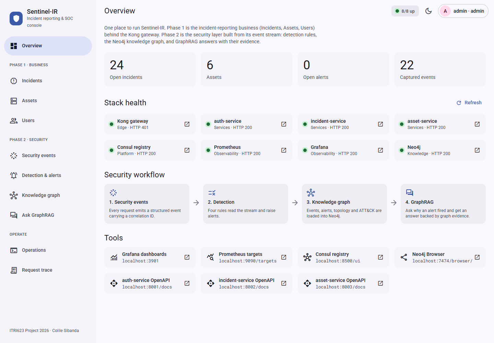
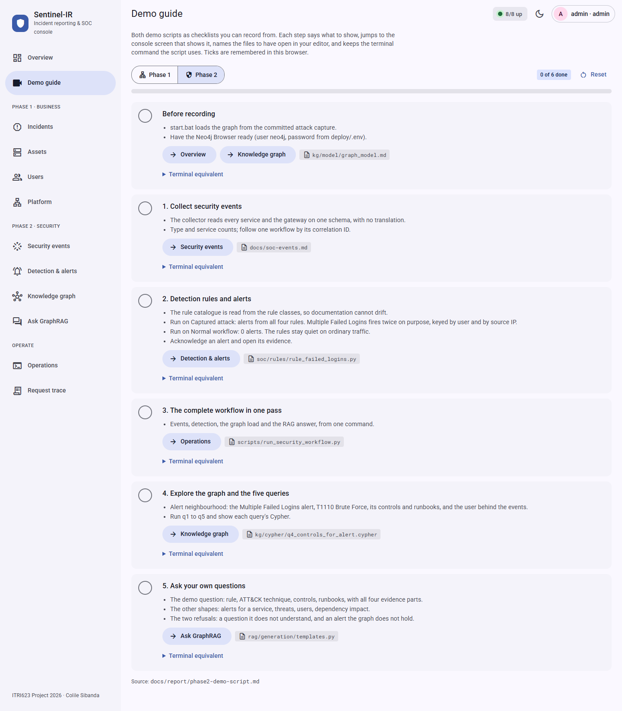
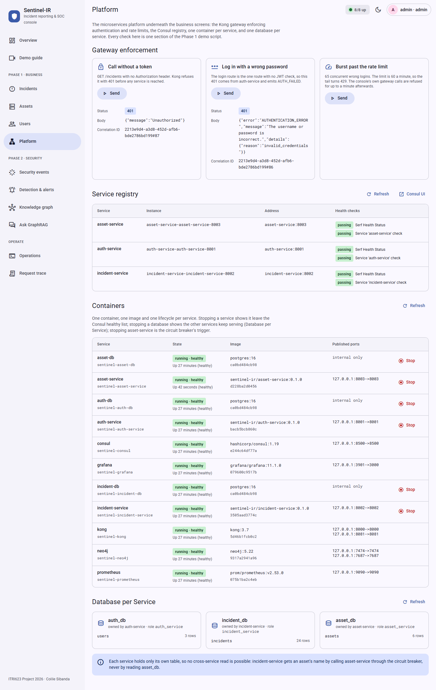
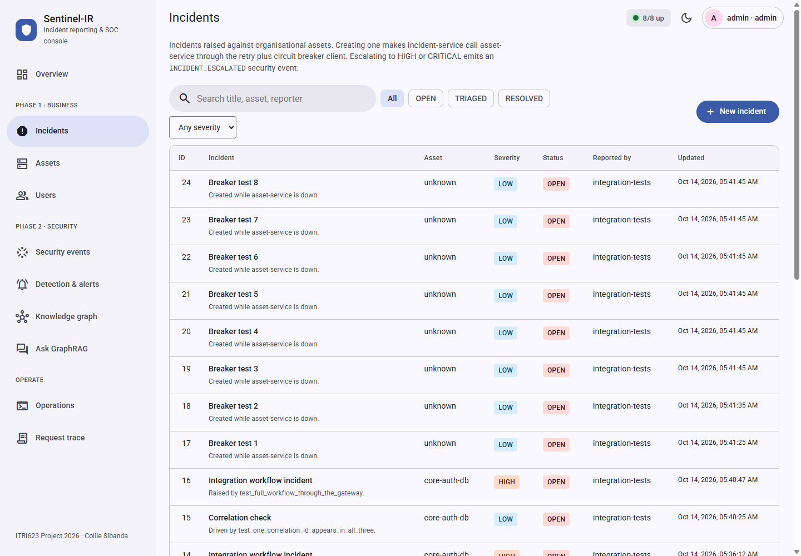
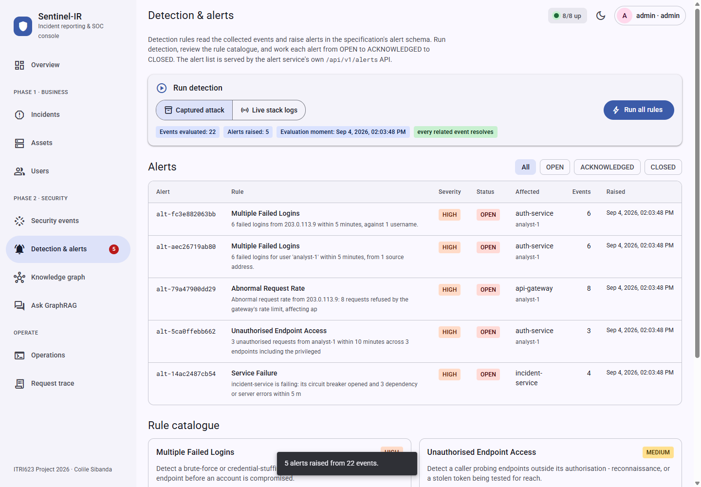
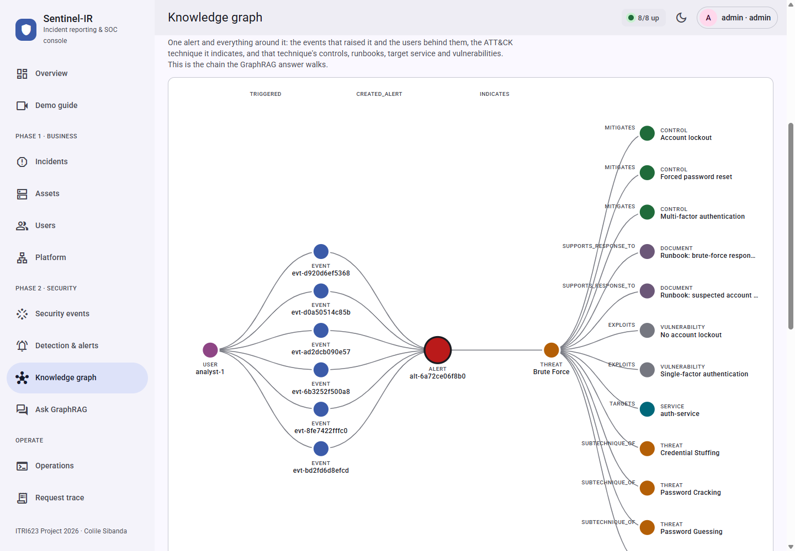
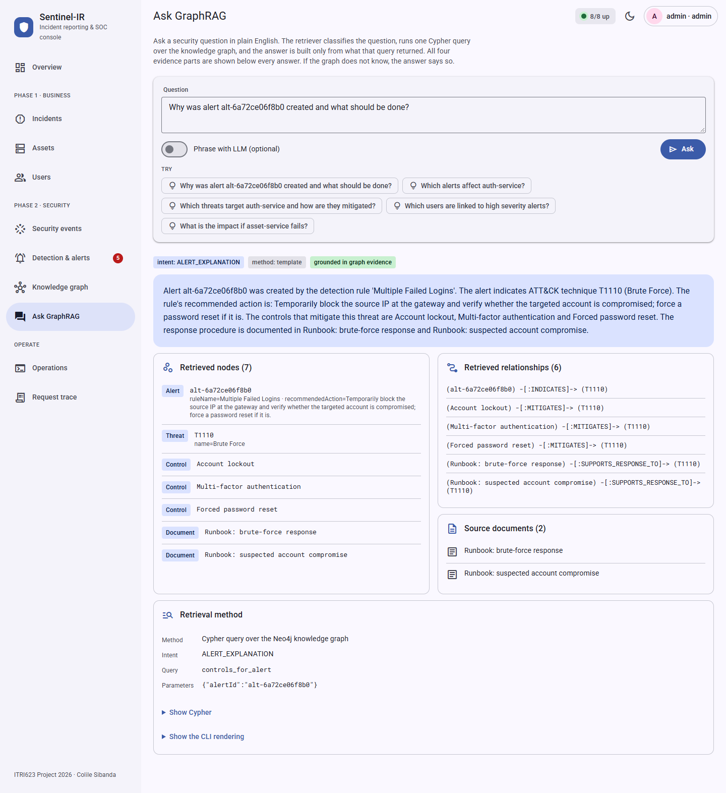

# The operator console

The console is one browser interface over the whole of Sentinel-IR. Every Phase 1 business
operation and every Phase 2 security stage can be driven from it: incidents, assets and users;
the platform underneath them (gateway enforcement, the Consul registry, the containers, one
database per service); the security event stream; detection and alert triage; the Neo4j
knowledge graph, an alert's neighbourhood drawn as a picture, and the six queries; GraphRAG
answers with their evidence; the project's own demo and evidence scripts; and a trace of every
gateway call with its correlation ID. A Demo guide turns both demo scripts into checklists, so
each demonstration video can be recorded from this one window.

It adds no new business logic. Each screen calls code the project already has (the gateway, the
SOC modules, the graph loader, the retriever) the same way that code's own CLI or client calls it.
So what the console shows is what the system does.



## Running it

```bat
console.bat
```

or, from `c_sentinel-ir/` in any shell:

```bash
python -m console.main          # http://127.0.0.1:8010
```

The console needs only the `.venv` that `setup.bat` builds. How much works depends on what else
is running:

| Running | What works |
|---------|-----------|
| The console only | The Demo guide; security events, detection and alert triage, the rule catalogue and a dry-run graph load, all against the committed captures (`docs/evidence/step15-attack-events.jsonl` and the normal workflow `step12-correlated-logs.jsonl`); the offline Operations actions |
| Plus the stack (`start.bat`) | All of the above, plus Incidents, Assets, Users, Platform, the live event source, the knowledge graph, GraphRAG, and every Operations action |

Sign in with the bootstrap admin from `deploy/.env` (`BOOTSTRAP_ADMIN_USERNAME`, normally `admin`,
and `BOOTSTRAP_ADMIN_PASSWORD`). The token is kept in the tab's `sessionStorage` and is gone when
the tab closes.

## Architecture

```
 Browser  (console/static: index.html, app.css, app.js)
    │  same origin, http://127.0.0.1:8010
    ▼
 console.main  (FastAPI, bound to 127.0.0.1 only)
    ├── gateway_proxy  /gateway/api/v1/*  ──HTTP──▶  Kong :8000 ──▶ auth / incident / asset services
    ├── stack_status   /console/api/status ──HTTP──▶  each service /health, Consul, Prometheus,
    │                                                  Grafana, Neo4j
    ├── platform_api   /console/api/platform/* ──HTTP──▶ Consul, Kong (probes)
    │                                          ──subprocess──▶ docker compose ps / stop / start / exec psql
    ├── soc_api        /console/api/soc/*   ──in-process──▶ soc.collector, soc.rules, AlertStore
    ├── alert router   /api/v1/alerts       (soc.alert_service.router, mounted unchanged)
    ├── graph_api      /console/api/graph/* ──in-process──▶ kg.cypher, kg.loader, rag ──Bolt──▶ Neo4j
    └── actions        /console/api/actions/* ──subprocess──▶ scripts/*.py, client/*.py, pytest
```

| File | Responsibility |
|------|----------------|
| `console/main.py` | Entry point. Shared logging and error handlers, mounts every router and the static UI. No logic |
| `console/settings.py` | Every address the console talks to, read from the environment with the stack's host ports as defaults; loads `deploy/.env`; puts Docker Desktop's CLI on `PATH` the way `start.bat` does |
| `console/gateway_proxy.py` | Relays the browser's business calls to Kong unchanged, returning status, body, `X-Correlation-ID` and the rate-limit headers |
| `console/stack_status.py` | Parallel health probes for the Overview screen; the Neo4j Bolt check every graph call makes first; the tool links |
| `console/platform_api.py` | Consul's registered instances and checks; the containers with their images; stop and start for the three services and their three databases only; each database's tables with exact row counts; the three gateway probes |
| `console/soc_api.py` | Event explorer with facets over three sources, rule catalogue, detection runs, and resolving an alert's `relatedEvents` back to full events |
| `console/graph_api.py` | The six queries with their Cypher, node counts per label, an alert's neighbourhood for drawing, graph reload, the graph's alert ids, and GraphRAG questions |
| `console/actions.py` | The fixed catalogue of runnable scripts and the runner |
| `console/static/` | The single-page UI: plain HTML, CSS and JavaScript, no framework and no build step |
| `console/tests/test_console.py` | The console's HTTP contract, with no containers running |
| `console.bat` | Launcher: checks the venv, starts the server, opens the browser |

## Screens and the features they reach

| Screen | What you can do | Project code it reaches |
|--------|-----------------|-------------------------|
| **Overview** | Health of all eight components; open incidents, assets, open alerts and captured events; the security workflow; links to Grafana, Prometheus, Consul, Neo4j Browser and each service's OpenAPI page | Each component's health endpoint; the gateway |
| **Demo guide** | Both demo walkthroughs as checklists: what to show at each step, buttons that jump to the screen that shows it, the files to have open in an editor, and the terminal command the script uses. Ticks are remembered in the browser | `console/static/app.js` (`DEMO_GUIDES`) |
| **Incidents** | List, filter by status and severity, and search. Raise an incident against an asset, edit it, move its status, change its severity, and delete it (admin) | `incident-service` through Kong, which calls `asset-service` through `ResilientClient` |
| **Assets** | List, filter by type, and search. Open an asset to see the incidents raised against it. Register, edit and remove assets (admin) | `asset-service` through Kong. Opening a CRITICAL asset emits `ASSET_ACCESSED` |
| **Users** | List accounts and create users (admin) | `auth-service` through Kong |
| **Platform** | Send the three gateway probes (no token: 401 from Kong; wrong password: 401 from auth-service; a 65-request burst whose tail turns 429). See every Consul-registered instance with its address and health checks. See every container with its state, image and published ports, and stop or start a service or its database. See each service's database and the only table in it | Consul's HTTP API; Kong; `docker compose` |
| **Security events** | Browse the event stream from the captured attack, the normal workflow, or the live stack logs. Filter by type, service, user and correlation ID. Click a correlation ID to see every event in that request | `soc.collector` (`build_store`, `select_source`) |
| **Detection & alerts** | Run all rules over any of the three sources (the normal workflow raises none); read the rule catalogue; move each alert from OPEN to ACKNOWLEDGED to CLOSED; see the events behind an alert; jump to GraphRAG about it | `soc.rules.catalogue`, `soc.rules.main.persist_alerts`, `soc.alert_service.router` |
| **Knowledge graph** | Node and relationship counts; reload the graph (dry run optional); draw any alert's neighbourhood (user, events, alert, technique, then its controls, runbooks, vulnerabilities, target service and sub-techniques) and click a node for its properties; run q1 to q5 with parameter pickers and see each query's Cypher | `kg.loader.main`, `kg.cypher.queries`, `kg.loader.connection.run_query` |
| **Ask GraphRAG** | Ask a question, or pick a suggestion built from real graph ids; try the two refusals; optional LLM phrasing; see the answer with all four evidence parts, the Cypher and the CLI rendering | `rag.generation.main.answer_question` |
| **Operations** | Run the project's scripts and read their output: verify, seed, business workflow, failed-login burst, circuit-breaker drill, evidence captures, the Phase 2 workflow, and the unit tests suite by suite | `scripts/`, `client/`, `pytest` |
| **Request trace** | Every gateway call this session made, with status, latency, remaining rate limit and correlation ID. Copy the ID, or look it up in the live events | The headers `gw()` records |








## Design decisions

**Business calls go through Kong, never to a service port.** The browser cannot call `:8000`
from `:8010` without CORS, so the console relays the calls instead of bypassing the gateway. As a
result JWT validation, rate limiting and correlation-ID stamping all still apply, and every click
lands on the security event stream exactly as a `client/api_client.py` call would.

**The UI chooses the correlation ID.** `gw()` sends a fresh UUID as `X-Correlation-ID` on every
call. Kong passes a client-chosen ID through unchanged, so the ID in the Request trace is the one
all three services logged. That is what makes the trace-to-events lookup work.

**The alert service's router is mounted unchanged.** The console and `/api/v1/alerts` share one
in-process `AlertStore`. The alerts a detection run stores are therefore served and updated by
the alert service's own, already-tested endpoints, not by a second copy of them.

**A detection re-run replaces the alerts.** `new_alert_id()` mints a random ID per firing, so
evaluating the same events twice would hold every alert twice. `AlertStore` gained `clear()` for
this, with its own test; the console clears the store before persisting a new evaluation.

**Three event sources, chosen per screen.** "Captured attack" is the committed attack capture and
needs no Docker. "Normal workflow" is the committed capture of an ordinary business workflow,
which shows the rules staying quiet (0 alerts). "Live stack logs" is `docker compose logs`. All
three resolve through `soc.collector.main.select_source`, the function the CLIs use, so the
console cannot read events differently from them.

**The Platform screen can only stop what is safe to stop.** Stop and start are limited to the three
services and their three databases, which are the containers the registry, Database per Service
and circuit-breaker demonstrations need. The gateway, Consul, Prometheus, Grafana and Neo4j are
refused with a 404, because stopping any of them would take the console's own view down with it.
Docker is driven with the same `docker compose --env-file deploy/.env -f deploy/docker-compose.yml`
command `start.bat` uses. Row counts are exact `count(*)` values, not `pg_stat` estimates, because
the estimates read 0 after every database restart.

**The neighbourhood is drawn as a chain, not a force layout.** Columns run user, events, alert,
technique, then everything the technique links to. That is the path the GraphRAG answer walks, so
the picture and the answer tell the same story. The layout is deterministic, so the same graph
always draws the same picture, which matters on a recording.

**A missing graph fails fast.** Every graph call first checks that Neo4j's Bolt port accepts a
connection and returns a plain 503 within a second if not, instead of waiting out the driver's
connection timeout.

**The Operations screen can only run what is written down.** The browser picks an action by ID
and can pass no arguments. Anything outside `ACTIONS` is a 404, and the server binds to
`127.0.0.1` only. The unit-test action runs each suite separately, per decision D-13.

**Plain Material Design, no framework.** Material 3 colour roles are CSS custom properties on
`:root`, redefined for dark mode, and components follow Material's own names: navigation drawer,
top app bar, cards, chips, segmented buttons, data tables, dialogs, side sheets, snackbars. There
is nothing to install or build, and the UI matches the project's no-hidden-state reproducibility
contract.

**Errors keep one shape.** The console installs the shared `install_error_handlers`, so its own
failures use the same `{error, message, details}` body as the services, and the UI shows the
message.

## How it was built

1. **Survey.** Read the README, `docs/api.md`, `gateway/kong.yml`, `deploy/docker-compose.yml`,
   and each Phase 2 entry point (`soc.collector.main`, `soc.rules.main`, the alert service,
   `kg.cypher.graph_service`, `kg.loader.main`, `rag.generation.main`) to list every feature and
   the function that owns it. The schemas fixed the form values: severities, incident statuses
   `OPEN`/`TRIAGED`/`RESOLVED`, alert statuses, and roles.
2. **Design.** Decided on a backend that only delegates, and on the four integration routes:
   proxy to Kong, in-process modules, the mounted alert router, and a subprocess for scripts.
3. **Backend.** Wrote the modules above, then tested every endpoint in-process with FastAPI's
   `TestClient`: rules, events, detection, alert status changes, cited events, dry-run load, query
   catalogue, status, the action 404, and the gateway proxy.
4. **Live check.** The stack was running, so the same calls were repeated against it: 8 of 8
   components up, the graph at 65 nodes and 130 relationships, and the step-19 question answered
   and grounded.
5. **Frontend.** Wrote `index.html` (the frame), `app.css` (tokens and components) and `app.js`
   (helpers, HTTP, overlays, session, one render function per screen, routing).
6. **Browser verification.** A small script drove headless Chrome over the DevTools protocol. It
   signed in, visited every screen, took screenshots, flagged horizontal overflow and collected JS
   errors. It also exercised the incident flow end to end (create through the dialog, escalate in
   the side sheet, delete, confirm gone, so no test data was left behind), ran q4, asked the demo
   question, and repeated the tour at phone width in dark mode.
7. **Fixes found by step 6.**
   - The menu button showed on desktop (a later `.icon-btn` rule overrode `.menu-btn`).
   - A query result could be written after you had left the screen (now guarded with
     `isConnected`).
   - Alert IDs wrapped, and incidents listed oldest first.
   - The scripts could not find `docker` because Docker Desktop was not on `PATH`.
   - The unit-test action ran one root `pytest` against D-13.
8. **Tests and documentation.** Added `console/tests/test_console.py`, the `AlertStore.clear`
   test, `console` in `pytest.ini`, `console.bat`, and this document.

### Second round: covering the rest of both demo scripts

9. **Gap check.** Walked both demo scripts section by section and listed what still needed a
   terminal: the gateway probes, the registry, the containers, Database per Service, the rules
   staying quiet on normal traffic, the graph picture, and the refusals.
10. **Backend.** Added `platform_api.py`, the normal-workflow event source, and the
    neighbourhood endpoint. Checked each against the live stack: 3 services registered with
    passing checks, 11 containers healthy, each database holding only its own table, 0 alerts on
    the normal workflow, and a 21-node neighbourhood for the brute-force alert.
11. **Frontend.** Added the Platform and Demo guide screens, the third source option, the
    neighbourhood picture with its property panel, and the refusal questions.
12. **Live drills.** Ran each new action on the stack:
    - The burst returned 60 × 401, then 5 × 429 "API rate limit exceeded".
    - Stopping `asset-service` turned its Consul check critical; 6 seconds after the restart both
      checks were passing.
13. **Fixes found by the drills.**
    - Built images showed as bare `sha256` ids, so names now come from `compose config`.
    - Row counts read 0 after a restart, so they are now exact counts.
    - The first, radial neighbourhood layout overlapped its labels and was replaced by the
      layered chain. Sub-techniques were moved out of the technique column.
    - On a phone the picture shrank past legibility, so it now keeps a minimum width and scrolls.

## Verification

```bash
python -m pytest console       # 13 passed, no containers needed
python -m pytest soc           # 95 passed, including AlertStore.clear
```

On the running stack:
- The Operations screen's *Verify the stack* returned "Preflight: all green".
- The live event source read the stack's events, including the `INCIDENT_CREATED` and
  `INCIDENT_ESCALATED` emitted by the console's own test incident.
- The Platform drills behaved as the Phase 1 demo script describes.

Every screen was toured in headless Chrome at desktop width, and at phone width in dark mode,
with no JS errors and no sideways page scroll. The screenshots in `evidence/console/` were taken
from the console against the live stack.

## Known limits

- Alerts live in memory, like the alert service's. Restarting the console empties them; run
  detection again.
- The graph loader raises its own alerts with their own IDs, so a console detection run and the
  graph hold different alert IDs for the same firings. The GraphRAG suggestions and the q4 picker
  therefore read IDs from the graph, and "Ask GraphRAG about this kind of alert" looks up the
  graph's alert from the same rule.
- Roboto and the Material Symbols icons load from Google Fonts. Offline, the text falls back to
  the system font and icons show as their names.
- An Operations action runs to completion before its output appears, up to 300 seconds. The
  circuit-breaker drill asks for confirmation because it stops `asset-service`.
- The rate-limit burst uses the minute's allowance, so the console's own gateway calls are refused
  with 429 for up to a minute afterwards. Run it last in a demonstration.
- The Platform screen and the live event source need Docker Desktop running; the console finds its
  CLI even when it is not on `PATH`.
- *Phrase with LLM* needs `GEMINI_API_KEY`. Without it the template generator answers, as it does
  on the CLI.

## Extending it

- **A new screen:** write `renderX(el)` in `app.js`, register it in `ROUTES`, and add a
  `nav-item` in `index.html`. Business calls go through `gw()`; console calls through `api()`.
- **A new backend capability:** add a router module under `console/` that delegates to the
  owning package, and include it in `console/main.py` before the static mount.
- **A new script:** add an `Action` to `ACTIONS` in `console/actions.py`. Nothing else needs to
  change.
