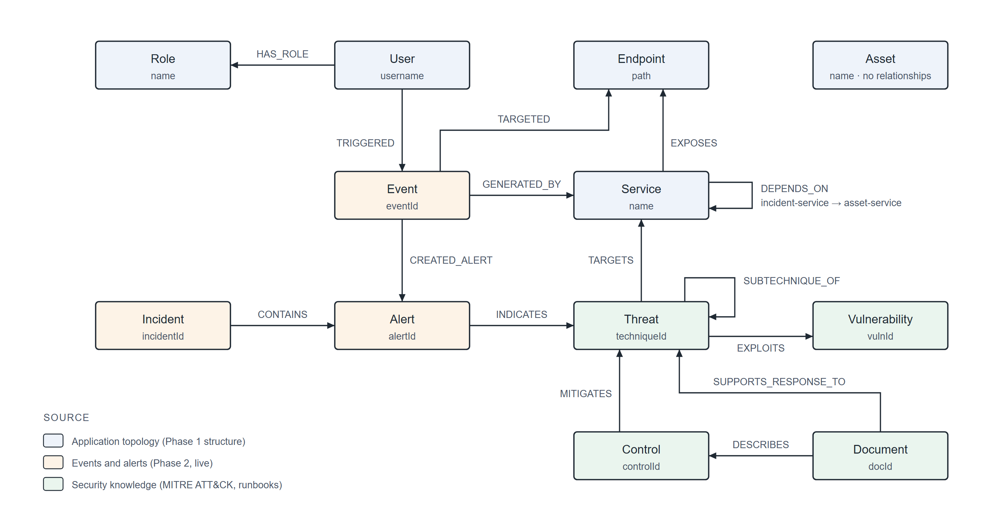

# Knowledge graph model — Sentinel-IR

The Neo4j security knowledge graph. Twelve node labels over three sources of knowledge —
what the application **is**, what **happened** in it, and what is **known** about the
threats those happenings suggest — connected by eighteen relationship types: the fourteen the
specification lists, plus `SUBTECHNIQUE_OF` for the MITRE sub-techniques and `ACCESSED`,
`CONCERNS` and `AFFECTS`, which tie events and incidents to the assets and incidents they
concern.

This document and [`graph_model.py`](graph_model.py) are the same model. The loaders in
`kg/loader/` build exactly the labels and relationships listed here; `schema.cypher` puts a
uniqueness constraint on each label's natural key. `kg/loader/tests/` asserts there is no
drift between the three.

## Node labels

| Label | Natural key | Key properties | Source | Participates in |
|-------|-------------|----------------|--------|-----------------|
| `User` | `username` | `username`, `role` | topology (from auth-service accounts) | `-[:TRIGGERED]->(:Event)`, `-[:HAS_ROLE]->(:Role)` |
| `Role` | `name` | `name` | topology | `(:User)-[:HAS_ROLE]->` |
| `Service` | `name` | `name`, `port`, `description` | topology (Compose + registry) | `-[:DEPENDS_ON]->(:Service)`, `-[:EXPOSES]->(:Endpoint)`, `(:Event)-[:GENERATED_BY]->`, `(:Threat)-[:TARGETS]->` |
| `Endpoint` | `path` | `path`, `method`, `protected` | topology (gateway routes) | `(:Service)-[:EXPOSES]->`, `(:Event)-[:TARGETED]->` |
| `Asset` | `name` | `name`, `assetType`, `criticality` | topology (asset-service register) | `(:Incident)-[:AFFECTS]->`, `(:Event)-[:ACCESSED]->` |
| `Event` | `eventId` | every key in `docs/soc-events.md` | events (`soc/collector`) | `(:User)-[:TRIGGERED]->`, `-[:GENERATED_BY]->(:Service)`, `-[:TARGETED]->(:Endpoint)`, `-[:CREATED_ALERT]->(:Alert)`, `-[:ACCESSED]->(:Asset)`, `-[:CONCERNS]->(:Incident)` |
| `Alert` | `alertId` | every key in the alert schema | events (`soc/alert_service`) | `(:Event)-[:CREATED_ALERT]->`, `-[:INDICATES]->(:Threat)`, `(:Incident)-[:CONTAINS]->` |
| `Incident` | `incidentId` | `incidentId`, `title`, `severity` (latest), `createdAt`, `reportedBy` | events (`INCIDENT_CREATED` / `INCIDENT_ESCALATED`) | `-[:CONTAINS]->(:Alert)`, `-[:AFFECTS]->(:Asset)`, `(:Event)-[:CONCERNS]->` |
| `Threat` | `techniqueId` | `techniqueId`, `name`, `tactic`, `description` | security knowledge (MITRE ATT&CK) | `(:Alert)-[:INDICATES]->`, `-[:TARGETS]->(:Service)`, `-[:EXPLOITS]->(:Vulnerability)`, `-[:SUBTECHNIQUE_OF]->(:Threat)`, `(:Control)-[:MITIGATES]->`, `(:Document)-[:SUPPORTS_RESPONSE_TO]->` |
| `Control` | `controlId` | `controlId`, `name`, `description` | security knowledge | `-[:MITIGATES]->(:Threat)`, `(:Document)-[:DESCRIBES]->` |
| `Vulnerability` | `vulnId` | `vulnId`, `name`, `description` | security knowledge | `(:Threat)-[:EXPLOITS]->` |
| `Document` | `docId` | `docId`, `title`, `kind` | security knowledge (response procedures) | `-[:DESCRIBES]->(:Control)`, `-[:SUPPORTS_RESPONSE_TO]->(:Threat)` |

## Relationship types

```
(:User)-[:TRIGGERED]->(:Event)                  a user's action produced an event
(:Event)-[:GENERATED_BY]->(:Service)            the service that emitted the event
(:Event)-[:TARGETED]->(:Endpoint)               the endpoint the event was about
(:Event)-[:CREATED_ALERT]->(:Alert)             an event a detection rule cited as evidence
(:Alert)-[:INDICATES]->(:Threat)                the ATT&CK technique the alert's rule detects
(:Threat)-[:TARGETS]->(:Service)                the service the technique is aimed at
(:Threat)-[:EXPLOITS]->(:Vulnerability)         the weakness the technique relies on
(:Threat)-[:SUBTECHNIQUE_OF]->(:Threat)         a MITRE sub-technique to its parent technique
(:Control)-[:MITIGATES]->(:Threat)              a countermeasure against the technique
(:Incident)-[:CONTAINS]->(:Alert)               an incident groups the alerts under it
(:Incident)-[:AFFECTS]->(:Asset)                the asset the incident was raised against
(:Event)-[:ACCESSED]->(:Asset)                  a CRITICAL asset was read
(:Event)-[:CONCERNS]->(:Incident)               the event raised or escalated the incident
(:Service)-[:DEPENDS_ON]->(:Service)            the real incident-service -> asset-service call
(:Service)-[:EXPOSES]->(:Endpoint)              a route the gateway publishes for the service
(:User)-[:HAS_ROLE]->(:Role)                    the account's authorisation role
(:Document)-[:DESCRIBES]->(:Control)            a procedure that documents a control
(:Document)-[:SUPPORTS_RESPONSE_TO]->(:Threat)  a runbook for responding to the technique
```

## The three sources

1. **Application topology** — `load_topology.py`. Services and their ports, the endpoints each
   exposes and whether the gateway protects them, the one real `incident-service -[:DEPENDS_ON]->
   asset-service` edge, the asset register, and the seeded user accounts with their roles.
2. **Live events and alerts** — `load_events.py`. Every `SecurityEvent` the collector holds and
   every `Alert` the rules raised, wired with `TRIGGERED`, `GENERATED_BY`, `TARGETED` and
   `CREATED_ALERT`. `CREATED_ALERT` is built from the alert's `relatedEvents`, which is why that
   list may not be empty. Incident events become `Incident` nodes (`CONCERNS`), linked to the
   asset named in `INCIDENT_CREATED` (`AFFECTS`); an `ASSET_ACCESSED` event is linked to the asset
   it read (`ACCESSED`). An incident `CONTAINS` every HIGH or CRITICAL alert with evidence in the
   30 minutes before it was raised — the time-window grouping a SOC uses when a responder opens an
   incident in reaction to what is firing.
3. **Security knowledge** — `load_security_knowledge.py`. MITRE ATT&CK **T1110 Brute Force** and
   its sub-techniques T1110.001–T1110.004, the weakness they exploit, and the controls that
   mitigate them — account lockout, multi-factor authentication and password reset — plus the
   response runbooks. `INDICATES` links the *Multiple Failed Logins* rule's alerts to T1110, so a
   failed-login alert reaches a control in three hops:
   `(:Alert)-[:INDICATES]->(:Threat)<-[:MITIGATES]-(:Control)`.

## Diagram



Drawn by `docs/diagrams/make_figures.py`; the three node colours mark the three sources.

Done when: `schema.cypher` applies cleanly to an empty database, `python -m kg.loader.main`
produces a graph holding every label above — `Incident` included, from the attack capture's
incident-response phase — a topology query returns
`incident-service -[:DEPENDS_ON]-> asset-service`, and T1110 with its controls is reachable
from a *Multiple Failed Logins* alert in three hops.
